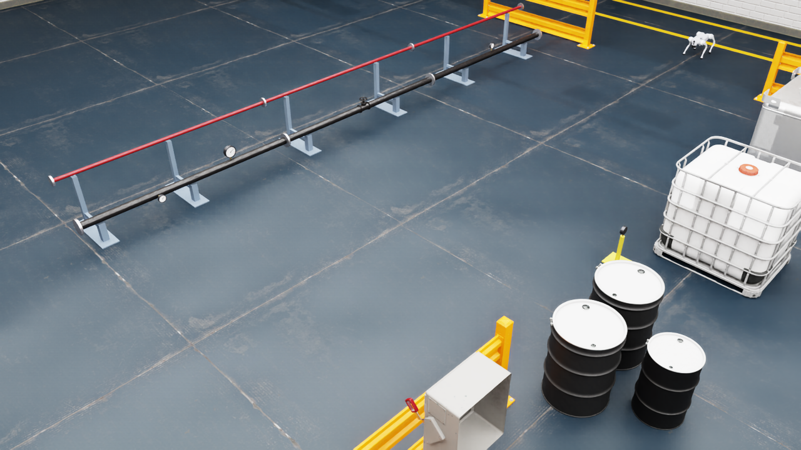

# Isaac Sim Go2 Inspection

Учебный проект по автоматическому осмотру приборов роботом Unitree Go2. В симуляции робот строит карту по лидару, локализуется на сохранённой карте, доезжает до манометра и снимает его камерой. Встроенный запускатель может передать снимок в экспериментальный алгоритм чтения стрелки.



## Что можно показать

| Режим | Результат |
| --- | --- |
| Nav2 и снимок | Робот едет к PI-101 (Gauge_01), останавливается, сохраняет кадр и запускает пробное чтение |
| Проверка отмены | Запускатель отменяет цель через 2 секунды после принятия |
| Статический куб | В симуляции ставится куб на проверенном участке, после теста удаляется |
| Новая карта | Ручной проход в Isaac с лидаром. Enter в терминале сохраняет карту в каталог запуска |
| CV на готовой фотографии | Число или причина отказа, JSON и PNG с разметкой. Isaac и ROS не нужны |
| Обход пяти приборов | Контрольный маршрут по известному проходу с позой из симулятора. Nav2 и ROS не нужны |

В живом Isaac проверен общий запуск: Nav2 доехал до Gauge_01, камера сохранила свежий снимок, пробное чтение вывело 6,41 бар, а робот вернулся в ручной режим. Статический объезд и отмена ранее проверены отдельными командами Nav2. На тесте со 100 синтетическими кадрами полный поиск дал 64 числовых ответа на 95 видимых приборах и 7 уверенных ошибок на всех 100 кадрах. При известной области из разметки получены 94 ответа из 95 и средняя ошибка 0,32% диапазона среди прочитанных приборов. Динамическое испытание, полная станция из четырёх типов приборов и проверка на физическом Go2 остаются в планах. См. [ревью CV](docs/REVIEW_R0_CV_2026-11-06.md) и [план переноса](docs/SIM_TO_REAL_ARCHITECTURE.md).

## Первый запуск на Windows

1. Склонируйте репозиторий в каталог без пробелов, например `D:\go2-inspection`.
2. Установите обычный Windows Python 3.12 x64. Для Nav2 через WSL нужны Isaac Sim 6.1 со встроенными ROS-библиотеками и скриптом `skills/isaac-sim-remote/scripts/isaacsim_send.py`, WSL2 Ubuntu 22.04 и ROS 2 Humble в WSL. Для обхода без ROS нужен Isaac, для отдельного CV достаточно Python и зависимостей.
3. Установите Python-зависимости из PowerShell в корне проекта. Для чистой копии удобно использовать отдельное окружение.

```powershell
git clone https://github.com/deathlydh/IsaacSim-go2-inspection.git go2-inspection
cd go2-inspection
py -3.12 -m venv .venv
.\.venv\Scripts\python.exe -m pip install -r requirements-cv.txt
```

4. Если нужен Nav2, в Ubuntu 22.04 WSL с уже установленным ROS 2 Humble выполните:

```bash
sudo apt install ros-humble-navigation2 ros-humble-nav2-bringup ros-humble-slam-toolbox
```

Стенд проверяли на Windows 10 Enterprise 22H2 с Isaac Sim 6.1 и WSL2 Ubuntu 22.04. Данные идут через relay из проекта. Подготовка ОС, установка ROS и ограничения Windows описаны в [передаче моста](docs/GO2_ROS2_HANDOFF.md). Сцена обращается к библиотеке ассетов NVIDIA, поэтому при первой загрузке нужен доступ к ней.

## Как показать

1. Откройте [start_factory.bat](start_factory.bat) в Проводнике и дождитесь появления робота в цехе. Для Nav2 оставьте симуляцию в Play и робота у стартовой метки. После каждого прохода верните исходную позу через **Stop → Play**, подождите, пока Go2 встанет, и запустите следующее испытание.
2. Откройте [run_demo.bat](run_demo.bat) и выберите режим. Навигационные пункты подключают мост, запускают Nav2, ждут готовности карты и проверяют TF перед движением. Меню запускает relay или использует один уже работающий relay. Закройте предыдущий запуск Nav2 или SLAM перед запуском меню.
3. Для отмены нажмите **Esc в окне Isaac**. Терминал покажет итог и путь к файлам. Для навигационных запусков это `reports/demo/<id>/index.html` и журналы рядом. При запуске без ROS для отмены также можно открыть `cancel_route.bat`.

Для запуска без меню используйте `run_demo.bat nav`, `run_demo.bat cv`, `run_demo.bat route`, `run_demo.bat cancel`, `run_demo.bat obstacle` или `run_demo.bat mapping`. Пункт CV можно выполнить до установки Isaac. Новая карта сохраняется как `reports/demo/<id>/map.yaml` с PGM. Чтобы использовать её для навигации, откалибруйте начальную позу и цель по [инструкции Nav2](docs/GO2_NAV2.md).

По умолчанию Isaac ищется в `D:\isaacsim`, WSL-дистрибутив называется `Ubuntu-22.04`. Для другого окружения задайте переменные в PowerShell и запустите нужный батник из того же окна. Окружение для двойного клика также можно задать через локальный `go2.local.bat` по примеру ниже. Этот файл игнорируется Git.

```bat
set "GO2_ISAAC_DIR=C:\isaacsim"
set "GO2_WSL_DISTRO=Ubuntu-22.04"
set "GO2_WINDOWS_PYTHON_EXE=C:\path\to\Python312\python.exe"
```

Меню автоматически использует `.venv\Scripts\python.exe`, если окружение создано как выше. Для проверки кода запустите `python -m unittest discover -s tests -v` в своём Python-окружении.

## Документация

- [Nav2, картирование и диагностика](docs/GO2_NAV2.md) — как собрать свою карту, сохранить её и запускать этапы по отдельности.
- [LiDAR и ROS 2](docs/GO2_ROS2_HANDOFF.md) — подключение, частоты, кадры, проверка моста и запись rosbag2.
- [Камера и данные для CV](docs/GO2_NAV2_CV_HANDOFF.md) и [контракт CV](docs/CV_CONTRACT.md).
- [Текущие задачи](docs/TODO.md) и [история проверок](docs/IMPLEMENTATION_LOG.md).
- [Сторонние материалы и лицензии](docs/ATTRIBUTION.md).

`scenes/` содержит сцену, `sites/` — площадку и сохранённую карту, `robots/` — профиль Go2, `tools/isaac/` и `tools/ros/` — интеграцию с симулятором и ROS, `inspection/` — логику миссии, `cv/` — распознавание. Каталоги `reports/` и `data/gauges/` создаются локально. Ссылки на конкретные записи испытаний в технических заметках доступны в исходной рабочей копии или после получения этих артефактов отдельно.
